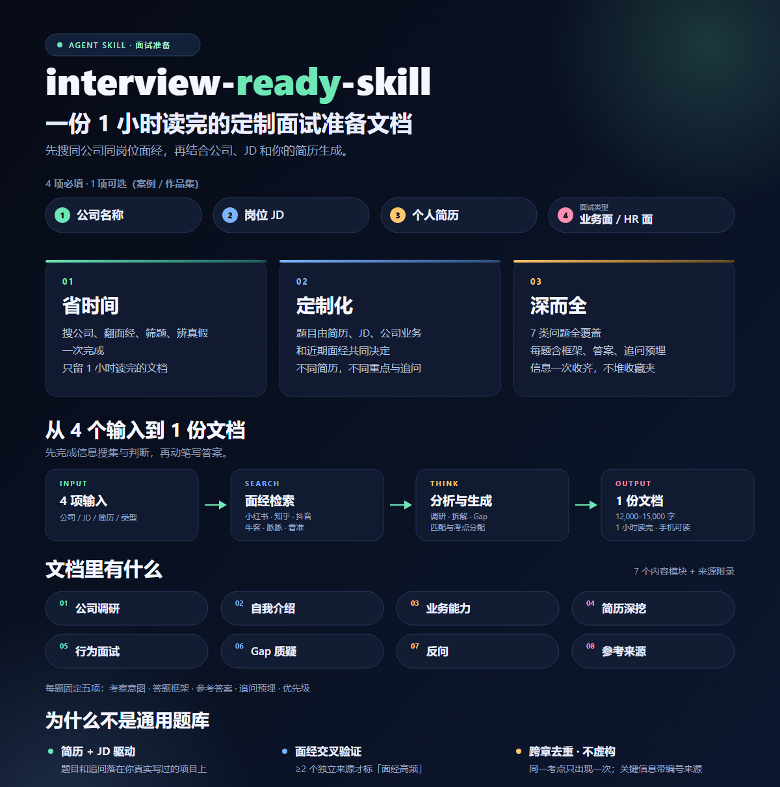

# interview-ready-skill

> 准备一场面试，只需要花 1 小时看完 AI 帮你准备的这份文档。  
> 先搜同公司、同岗位的近期面经，再结合公司、JD、你的简历和面试类型，给你输出一份能直接开口用的答案。

`Agent Skill` · `Markdown` · `中文` · `单文件交付`

<p align="center"> </p>

---

## 为什么需要它

面试准备真正耗时的，是调查公司、翻面经、筛题目、辨真假。这个 Skill 把这些工序一次做完，最后只留给你一份 1 小时读完的文档。

### 1. 帮你省时间，尤其是在时间最紧的时候

- 自动完成公司调研、同岗位面经检索、JD 拆解、题目筛选和答案组织，不需要你刷几十篇帖子、反复拼提示词。
- 即使面试准备时间不足，或者不想把时间花在搜集整理上，也能直接拿到一份完整、能开口用的材料；把省下的时间留给模拟表达。

### 2. 根据你的简历和 JD 定制，不是通用题库

- 题目由你的简历、目标岗位 JD、该公司业务和同岗位近期面经共同决定，追问会落在你真实写过的项目上。
- 同一个岗位，不同简历会得到不同的重点、不同的 Gap 和不同的追问，准备更贴人，胜算更高。

### 3. 比常见的面试资料更深、更全

- 覆盖面试官可能问的完整类型：公司调研、自我介绍、业务能力、简历深挖、行为面、Gap 质疑、反问。
- 每题不只有答案，还有考察意图、答题框架、参考答案、追问预埋和优先级；把散落在官网、财报、面经平台的信息一次收齐并结构化，省掉大量检索与比对时间。

### 4. **AI 资料不敢信？只看最真实的信息源**

- 不虚构经历、业务和数据；关键信息带编号来源，搜不到就明确写「未检索到」，不编造。

## 一份文档里有什么

| 章节        | 内容                                      |
| --------- | --------------------------------------- |
| 0 使用说明    | 元信息、面经检索状态、按面试类型的阅读顺序、图例                |
| 1 公司与岗位调研 | 业务、产品、文化、近 12 个月动态 + 3~5 条能直接说出口的「公司理解」 |
| 2 自我介绍    | 1 分钟版 + 3~5 分钟版，可直接朗读                   |
| 3 业务能力考察  | 岗位专业题，含考察意图、答题框架、参考答案、优先级               |
| 4 简历深挖    | 针对你简历里的项目逐条预判追问，并预埋下一层问题                |
| 5 行为面试    | 困难、冲突、失败、高压、规划、离职原因等，STAR 结构            |
| 6 Gap 质疑  | 针对你与岗位的真实差距，给出可说服面试官的回答                 |
| 7 反问      | 低风险、能加分的反问，按类型配比                        |
| 附录        | 参考来源，分「公司资料」与「面经」两组，按正文编号排列             |

## 安装

### 方式一：把 GitHub 链接直接发给你的 AI Agent（最省事）

把仓库链接发给 Claude Code、Codex、Cursor、Trae 等任一支持 Skill 的 Agent，只需发送一句安装要求即可：

```text
帮我安装这个 Skill：https://github.com/XiaqiuOO/interview-ready-skill
```

### 方式二：手动安装

直接解压压缩包，把 `interview-ready-skill` 文件夹放进对应技能目录，确认 `SKILL.md` 位于该文件夹根目录，然后重启应用或新开会话。

## 怎么用

**四项必填**：公司名称、岗位 JD、个人简历、本场面试类型（业务面 / HR 面）。

**一项可选**：案例、作品集（文件、文本或链接均可），用于补充项目细节和业务题素材。

可以直接这样说：

```text
帮我准备 XX 公司的 HR 面，简历和 JD 已发。
```

收到后它会直接生成文档，缺少必填项时才会一次性问清。

## 输出规格

- 单个 `.md` 文件，命名为 `{公司}_{岗位}_面试准备.md`；
- 全文 **12,000~15,000 字**，控制在 1 小时阅读量内；
- 手机端可读：标题不超过三级、表格不超过 4 列、无横向滚动；
- 每题都有字数上限，答案按「结论句 + 分点 + 证据」组织，重点加粗；
- 不编造简历、公司业务与数据；关键数据和面经带编号来源，末尾可核查；
- 业务面与 HR 面使用不同的题量配比和内容重心。

## 适用与不适用

**适合**：已经拿到面试邀约，有明确 JD 和面试类型，想在一两个小时内完成针对性准备的人。

**不适合**：简历代写、模拟面试、通用题库、多轮全流程打包、薪资谈判、PDF/Word/PPT 导出。

## 说明

- 面试类型只分**业务面**和 **HR 面**两类；一面、二面、专业面、主管面等都归入业务面，避免过度拆分导致准备重点摇摆。
- 会先检索小红书、知乎、抖音、牛客、脉脉等平台的同公司同岗位近期面经；只有 ≥2 个独立来源重复出现的考点才标为「面经高频」，用于排序，不替代 JD 硬性要求。搜不到时会明确写「未检索到有效面经」，不编造。
- 公司公开信息稀少或无法联网时，会明确标注「未核实」并给出信息边界，而不是用推测填满文档。
- 如果你希望增加行业、岗位类别或输出格式，欢迎提 Issue。

## 开发者

- 虾球欧欧（小红书、抖音同名）
- Github地址：[XiaqiuOO (虾球)](https://github.com/XiaqiuOO)
